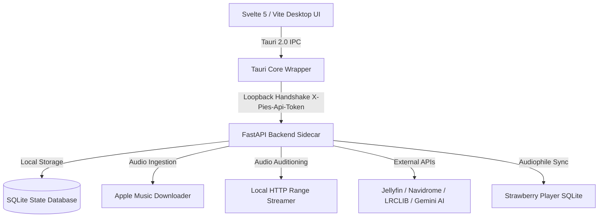

# Pies Pear Music 🍐🎵

> **The Local-First, High-Fidelity Music Archival & Workstation Hub**  
> Bit-perfect Apple Lossless (ALAC/FLAC) syncing, universal cross-service playlist matching, embedded auditioning player, automated Jellyfin & Navidrome streaming server integration, and Gemini AI music curation.

[](#platform-support)
[](app/)
[](alac_rip/)
[](#key-features)
[](tests/)
[](LICENSE)

---

## ✨ Key Features

* 💎 **Bit-Perfect Lossless ALAC/FLAC**: Download and archive albums and playlists from Apple Music in uncompressed, bit-perfect high-resolution audio (up to 24-bit / 192kHz).
* ⚡ **High-Performance Virtual Library**: Seamlessly browse and search 10,000+ track libraries at 60fps with lightweight virtual DOM windowing and low memory consumption.
* 🎧 **Embedded Audio Mini-Player**: Persistent auditioning player with instant local file streaming, waveform seeking, volume control, and OS Media Session keyboard keys (Play/Pause/Skip).
* 🎤 **Synchronized Karaoke Lyrics**: Displays timed `.lrc` lyrics with automatic fallback to [LRCLIB](https://lrclib.net) to download and save synchronized lyrics sidecars alongside your music.
* 🔄 **Universal Playlist Importer (Match-and-Rip)**: Ingest playlist links or export files from **Spotify, Tidal, Qobuz, Apple Music, CSV, and M3U8** — automatically resolves tracks via ISRC and downloads them in pristine Apple Lossless.
* 🤖 **Gemini AI Music Intelligence**: Plug in your Gemini API key for deep library taste profiling, natural-language smart playlist generation (*e.g. "Create a 25-track late-night moody synthwave mix"*), and 1-click lossless ripping.
* 📡 **Home Media Server Auto-Refresh**: Instant background webhook notifications to **Jellyfin** (`/Library/Refresh`) and **Navidrome / Subsonic** (`/rest/startScan.view`) whenever new music lands.
* 🍓 **1-Click Strawberry Sync & DAP Export**: Export playlists straight into Strawberry Music Player's SQLite library or transcode/sync directly to portable DAPs and microSD cards.
* 🎨 **Visual Customization & Wallpaper Engine**: WCAG AAA high-contrast themes (Amber Night, Midnight, OLED, Forest, etc.) plus custom wallpaper background uploads with live blur and dimming sliders.

---

## 🏛️ Architecture Overview

Pies Pear Music uses a modern, sandboxed desktop architecture with an isolated loopback sidecar:



---

## 🚀 Getting Started

### 1. Prerequisites

Ensure the following tools are installed on your system:
* **Linux**: `ffmpeg`, `flac`, and `apple-music-downloader` (placed in `~/.local/share/pies-alac-rip/amd-main`).
* **Node.js**: v18+ (for building the frontend).
* **Python**: 3.12+ (for running the backend sidecar).

*(Tip: The built-in **Diagnostics** screen automatically checks and verifies all installed system dependencies).*

---

### 2. Running from Source

Clone the repository and install dependencies:

```bash
# Clone the repository
git clone https://github.com/ilikepie96mng/pies-alac-rip-tool.git
cd pies-alac-rip-tool

# Set up Python virtual environment
python3 -m venv .venv
source .venv/bin/activate
pip install -e ".[test,package]"

# Install frontend dependencies
cd app
npm install
```

Start the application in development mode:

```bash
# Inside the app/ directory
npm run tauri dev
```

---

### 3. Building Production Packages

To build standalone Linux packages (`.AppImage`, `.deb`, `.rpm`) and freeze the backend sidecar:

```bash
# Freeze the Python sidecar binary
bash scripts/build-backend-sidecar.sh

# Build all package bundles
bash scripts/build-packages.sh

# Run packaging smoke verification
bash scripts/verify-packaging.sh
```

Packaged artifacts will be generated in `app/src-tauri/target/release/bundle/`.

---

## ⚙️ Configuration & Integrations

Settings can be managed directly in the application UI (**Settings**) or via `config.yaml`:

### Jellyfin Auto-Refresh
```yaml
integrations:
  jellyfin:
    enabled: true
    server_url: "http://192.168.1.100:8096"
    api_key: "your_jellyfin_api_key"
    auto_refresh: true
```

### Navidrome / Subsonic Auto-Refresh
```yaml
integrations:
  navidrome:
    enabled: true
    server_url: "http://192.168.1.100:4533"
    user: "admin"
    token: "your_subsonic_token"
    salt: "your_salt"
    auto_refresh: true
```

### Gemini AI Music Intelligence
```yaml
gemini_api_key: "AIzaSy..."
gemini_model: "gemini-2.5-flash"  # or gemini-2.5-pro
```

---

## 🧪 Testing & Code Quality

The repository enforces 100% automated test coverage across both backend and frontend:

```bash
# Run backend test suite (268 unit & integration tests)
.venv/bin/pytest

# Run frontend typechecking and Svelte diagnostics
cd app && npm run check
```

---

## 📂 Repository Structure

| Path | Description |
| :--- | :--- |
| [`app/src/lib/`](app/src/lib/) | Svelte 5 desktop interface, player bar, virtual track table, and modals |
| [`app/src-tauri/`](app/src-tauri/) | Tauri 2.0 launcher, native desktop notifications, and capability boundaries |
| [`alac_rip/`](alac_rip/) | FastAPI backend sidecar, audio streamer, metadata, and service integrations |
| [`tests/`](tests/) | Python unit, API boundary, audio streaming, and regression test suites |
| [`scripts/`](scripts/) | Packaging, sidecar freezing, and verification smoke test harnesses |
| [`docs/`](docs/) | Technical specifications, architecture docs, and agent workflow guidelines |

---

## 📖 Documentation Index

* 🛠️ **[Agent Workflow Protocol](docs/agent-workflow.md)** — Decoupled session lifecycle and handoff rules.
* 🏛️ **[Architecture & Security](docs/architecture.md)** — Capability model, sidecar isolation, and token exchange.
* 📦 **[Packaging Guide](docs/packaging.md)** — Distribution bundles, dependencies, and smoke tests.
* 🎨 **[Appearance & Themes](docs/appearance.md)** — Preset tokens, WCAG contrast, and wallpaper engine.
* 🔧 **[Troubleshooting](docs/troubleshooting.md)** — Common setup questions, audio playback, and sync recovery.

---

## 🛡️ Responsible Use & Non-Affiliation

Pies Pear Music is an open-source, local-first archival and library management tool for content you are authorized to access. It is not affiliated with, endorsed by, or sponsored by Apple Inc., Spotify, Tidal, Qobuz, or Google. See [RESPONSIBLE_USE.md](RESPONSIBLE_USE.md) and [LICENSE](LICENSE) for details.
