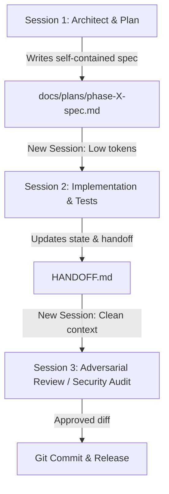

# AI Agent Workflow & Token Optimization Protocol

## Purpose
To maintain fast execution, high accuracy, and minimal token consumption, this repository uses a decoupled **"Pass the Parcel"** workflow. Rather than running long continuous chat conversations where the token snowball inflates costs, work is structured across isolated sessions using standalone Markdown files as contracts.

---

## The 4-Session Lifecycle

### 1. Session 1: Planning & Specification
* **Objective**: Understand user intent, explore existing code, and draft the technical specification.
* **Rule**: Write **zero code** in this session (other than the plan file).
* **Deliverable**: `docs/plans/phase-X-spec.md` containing:
  - Exact goal and acceptance criteria.
  - Affected files and function signatures.
  - Test strategy and commands.
  - Edge cases and security guardrails.

### 2. Session 2: Implementation & Verification
* **Objective**: Open a **brand new conversation** with fresh context. Read only `docs/plans/phase-X-spec.md` and the targeted source files.
* **Actions**: Implement the required code, write unit/integration tests, and run automated checks (`pytest`, `npm run check`).
* **Deliverable**: Clean code changes + updated `HANDOFF.md`.

### 3. Session 3: Adversarial Security & Quality Review
* **Objective**: Open a **brand new conversation** (e.g. Codex or Sol audit agent).
* **Actions**: Inspect `git diff` against the acceptance criteria, run the security audit checklist, and verify test assertions.
* **Deliverable**: `docs/security-review-<date>.md` or approval to commit.

---

## Token Efficiency Rules for Agents
1. **Never carry dead context**: When a milestone is done, summarize to `HANDOFF.md` and instruct the user to start a fresh chat.
2. **Stand on your own**: Any spec written to `docs/plans/` must be completely understandable by an agent with zero previous chat context.
3. **Keep state in git & docs**: The source of truth is always the filesystem (`docs/`, `HANDOFF.md`, `tests/`), never the conversation transcript.
